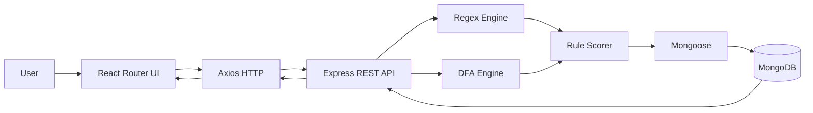
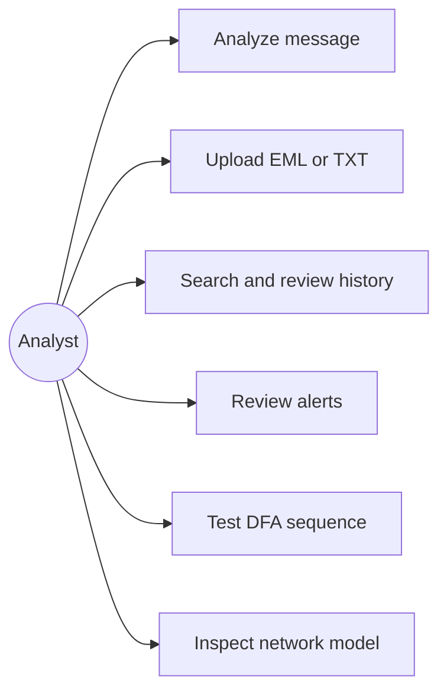
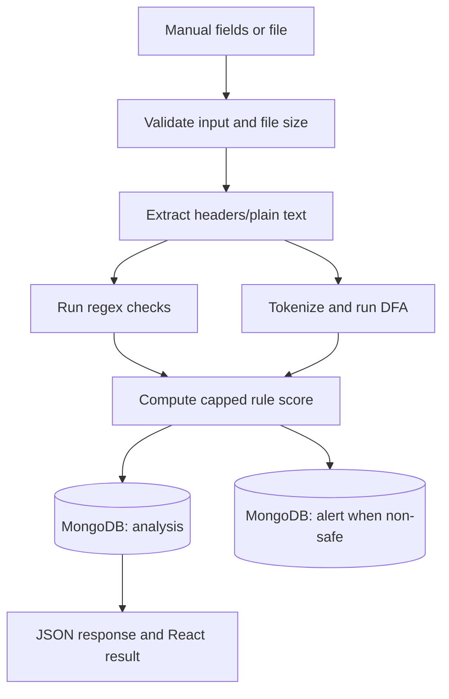

# System requirements and design

## Abstract
EmailGuard is a MERN application that analyzes email text with explicit regular expressions and a deterministic finite automaton. It assigns an explainable risk score, stores the result in MongoDB, and lets an analyst review history and alerts. Its network page shows the application's HTTP client/server flow and distinguishes it from lower OSI layers.

## Problem statement and objectives
Suspicious messages often combine misleading urgency, credential requests, promotional phrases, and risky links. A learner needs to see how web APIs, network communication, regex, and automata can work together in a usable application. Objectives: accept text and mail files; report reproducible rule evidence; persist and review results; demonstrate a real REST client/server exchange; and visualize a DFA's transition history.

## Existing and proposed system
The existing manual approach depends on a reader noticing suspicious cues and does not provide repeatable scoring or an audit trail. The proposed system normalizes email input, applies regex and DFA checks, computes a capped transparent score, persists the result and associated alert, and presents results through a React client.

## Functional requirements
- Enter email fields or upload `.eml`/`.txt` (maximum 1 MB).
- Score and explain rule matches; inspect regex and DFA evidence.
- List, search, filter, inspect, update review state, and delete analysis records.
- View database-backed totals, recent analyses, and manageable security alerts.
- Test a DFA token sequence and view its steps.
- Inspect actual client-side API timing events and backend request logs.

## Non-functional requirements
Input limits, safe error messages, Helmet headers, CORS allowlist, rate limiting, Mongoose schema validation, safe text rendering, responsive layout, and environment-based configuration. MongoDB availability is required for persistence.

## Software and hardware requirements
Node.js 20+, npm, MongoDB 6+ or Atlas, modern browser, and a development computer with 4 GB RAM recommended. Internet is needed only to install packages or use a hosted database.

## Architecture

## Use case diagram

## Data flow diagram

## Database design
`EmailAnalysis` stores sender, recipient, subject, body, class, 0–100 score, triggered rules, regex results, DFA result, extracted URL strings, review status, and Mongoose timestamps. `SecurityAlert` references an analysis and stores type, severity, description, evidence summary, status, and timestamps. Deleting an analysis also removes its associated alerts. Raw uploads are held in memory and not persisted.

## Computer Networks integration
Axios issues HTTP requests to Express. The browser records method, endpoint, start/end times, status, and elapsed duration for actual API calls; Express logs actual received requests and response durations. HTTP/JSON is application-level. TCP transport, IP routing, Ethernet/Wi-Fi framing, and physical signaling are performed by the OS/network hardware. TCP/IP layers are mapped in the UI. EmailGuard itself does not route packets, frame Ethernet, or implement TCP congestion control.

## FLAT integration
Regex patterns identify syntax and suspicious text features. The DFA state set is `{q0,q1,q2,q3}`, alphabet `{S,N}`, initial state `q0`, and accepting set `{q3}`. An S advances q0→q1→q2→q3; N resets to q0; q3 loops on S. The implementation records every transition. It consumes tokens derived from body and subject text using a fixed educational suspicious-token vocabulary.

## Regex implementation
The email regex checks basic address syntax only, not mailbox existence. Other global patterns identify suspicious/marketing vocabulary, select high-risk URL shapes, repeated punctuation, uppercase runs, and urgency phrases. Each result returns pattern name, description, matches, count, and accepted status.

## DFA implementation
`backend/algorithms/dfaEngine.js` runs the deterministic transition table for supplied S/N tokens, returns initial/final state, sequence, transition history, and acceptance. Both API and visualizer use the same table semantics.

## Testing and results
Automated Node tests cover address syntax, safe/suspicious/spam scoring, repeated spam and risky URL evidence, DFA accepted sequence, and rejected sequence. Run `cd backend && npm test`. No executed result is recorded until the test command is run in the target environment. Database CRUD and upload route integration require MongoDB and are not covered by the current test file.

## Conclusion
The implementation demonstrates a complete educational flow from React input through HTTP APIs and explainable regex/DFA analysis to MongoDB persistence. Rule-based results can be inspected, reviewed, and deleted.

## Future enhancements
Add MongoDB-backed API integration tests; safer attachment metadata inspection; configurable admin-managed weights; more robust URL normalization; authenticated multi-user access; mail-provider integrations; and an optional external reputation feed behind explicit privacy controls.
